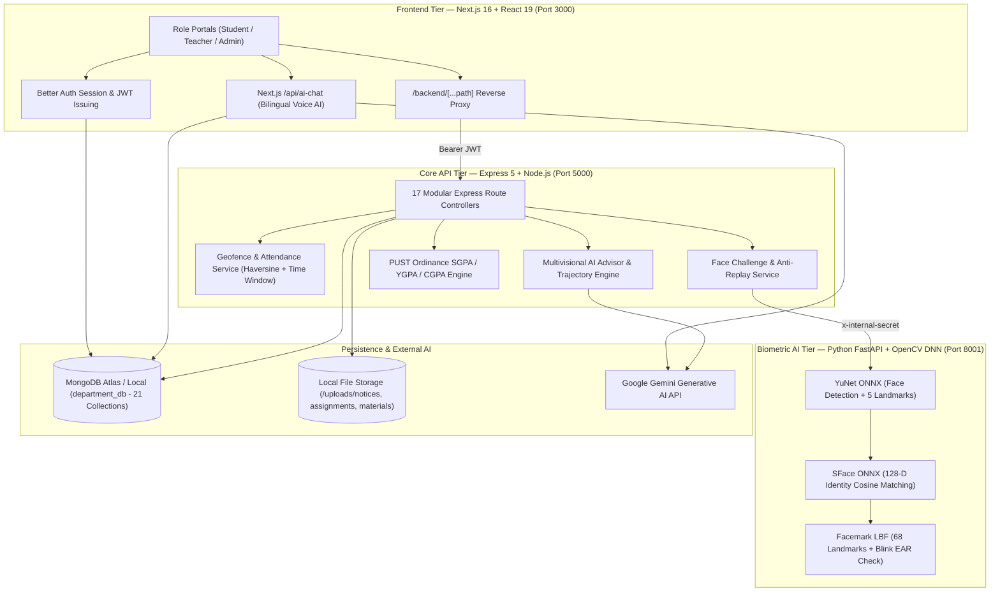
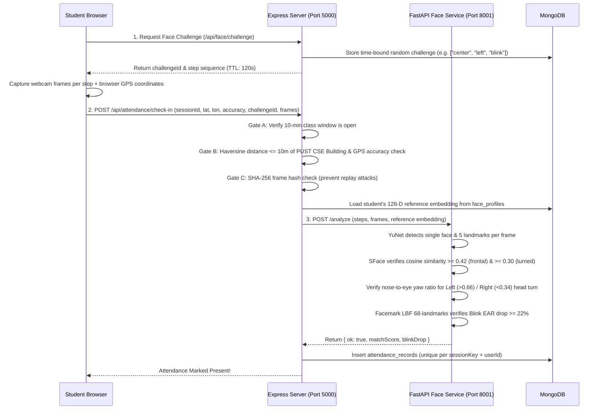

# 🎓 PUST CSE Smart Academic & Department Management Platform

**Department of Computer Science & Engineering (CSE)**  
**Pabna University of Science and Technology (PUST), Pabna-6600, Bangladesh**

A production-grade, full-stack **Smart University Department Ecosystem** engineered for the **Department of Computer Science & Engineering at PUST**. This platform unifies **Biometric Facial Liveness & 10-Meter GPS Geofence Attendance**, **PUST Ordinance-Compliant 8-Semester Result & Transcript Processing**, **Multivisional AI Academic Advising**, **Conflict-Free Routine Scheduling**, **Coursework & Class Test Management**, **AI Document-to-Note & Quiz Generation**, **Voice-Enabled Circular Broadcasting**, and **Anonymous Grievance Redressal** into a single cohesive system.

---

## 📑 Table of Contents

1. [System Architecture & Microservice Topology](#-1-system-architecture--microservice-topology)
2. [Technology Stack](#-2-technology-stack)
3. [Core Features & Role-Based Portals](#-3-core-features--role-based-portals)
   - [Student Portal & Course Workspaces](#31-student-portal--course-workspaces)
   - [Teacher Portal & Classroom Command Hub](#32-teacher-portal--classroom-command-hub)
   - [Administrator Command Center](#33-administrator-command-center)
4. [Biometric Facial Liveness & GPS Geofence Attendance Engine](#-4-biometric-facial-liveness--gps-geofence-attendance-engine)
5. [PUST Ordinance Result, Grading & Mathematical Engine](#-5-pust-ordinance-result-grading--mathematical-engine)
6. [Multivisional Academic AI Advisor & AI Study Suite](#-6-multivisional-academic-ai-advisor--ai-study-suite)
7. [Complete 8-Semester PUST CSE Curriculum](#-7-complete-8-semester-pust-cse-curriculum)
8. [Monorepo Directory Structure](#-8-monorepo-directory-structure)
9. [MongoDB Database Collections & Indexing](#-9-mongodb-database-collections--indexing)
10. [Complete REST API Reference](#-10-complete-rest-api-reference)
11. [Environment Variables & Configuration](#-11-environment-variables--configuration)
12. [Installation, Setup & Running the Project](#-12-installation-setup--running-the-project)
13. [Testing & Verification](#-13-testing--verification)

---

## 🏗️ 1. System Architecture & Microservice Topology

The project is architected as a **3-tier distributed monorepo** consisting of:
1. **`web/department-client` (Port `3000`)**: Next.js 16 (App Router) + React 19 frontend, Better Auth session server, and `/backend/*` reverse proxy.
2. **`web/department-server` (Port `5000`)**: Node.js + Express 5 core REST API server managing business logic, academic calculations, file uploads, and MongoDB persistence.
3. **`ml/face-service` (Port `8001`)**: Stateless Python FastAPI + OpenCV DNN microservice executing YuNet face detection, SFace 128-D biometric verification, and Facemark LBF 68-landmark eye-blink liveness analysis.



---

## 💻 2. Technology Stack

| Layer | Technologies & Libraries |
| :--- | :--- |
| **Frontend (`web/department-client`)** | Next.js `16.3.4` (App Router), React `19.2.8`, Tailwind CSS `v4`, HeroUI (`@heroui/react`), Framer Motion `13.2`, GSAP `3.15`, Lenis Smooth Scroll, Recharts `3.10`, Lucide React, React Hot Toast |
| **Authentication & Security** | Better Auth (`better-auth` + `@better-auth/mongo-adapter`), `jose` JWT verification (`HS256` / JWKS), Role-Based Access Control (`student`, `teacher`, `admin`), Account Approval Gate |
| **Backend (`web/department-server`)** | Node.js, Express `5.2.1`, MongoDB Native Driver `7.6.0`, Multer `2.4` (multipart uploads), `pdf-parse` (PDF text extraction), `mammoth` (DOCX text extraction) |
| **Biometric ML (`ml/face-service`)** | Python `3.10+`, FastAPI, Uvicorn, OpenCV Contrib (`opencv-contrib-python-headless`), NumPy, Pydantic, **YuNet** (`2023mar.onnx`), **SFace** (`2021dec.onnx`), **Facemark LBF** (`lbfmodel.yaml`) |
| **AI & Intelligence** | Multivisional Rule + Counterfactual Simulation Engine, Google Gemini REST API (`gemini-2.5-flash` / `gemini-2.0-flash`), Web Speech API (`SpeechRecognition` & `speechSynthesis`) |

---

## 🌟 3. Core Features & Role-Based Portals

The platform strictly enforces a **3-role architecture** (**Student**, **Teacher**, and **Administrator**). Newly registered users enter a **Pending Verification Queue** (`/pending`) until verified and approved by a Department Administrator.

### 3.1 Student Portal & Course Workspaces (`/dashboard/student`)
- **6-Section Step-Navigated Dashboard**:
  1. **Overview & Academic Identity**: Student profile card, biometric face enrollment status, active semester badge, quick KPI counters, and live visual analytics.
  2. **Weekly Class Routine**: Interactive day-by-day and full-week schedule filtered automatically for the student's active semester, displaying room allocations and course instructors.
  3. **Smart Biometric & Geofence Attendance**: Live class check-in radar showing active 10-minute attendance windows, GPS distance from the PUST CSE Building, one-click camera liveness check-in, and per-course attendance history.
  4. **Coursework, Assignments & Study Materials**: Filterable assignment hub with file upload submission, teacher feedback and grading scorecards, plus downloadable lecture slides and syllabus PDFs.
  5. **Official Academic Results, Transcript & Multivisional AI Advisor**:
     - Interactive semester-by-semester transcript viewer (Semesters 1 to 8) with PUST Ordinance marks breakdown (`Attendance /10`, `CA /20 or /30`, `Final Exam /70 or /60`, `Total /100`, `Grade`, `GP`, `SGPA`, `YGPA`, `CGPA`).
     - Printable/exportable official grade sheets.
     - **8-Semester Degree Forecast & Multivisional AI Advisor** with an interactive progression curve and full-featured academic chatbot.
  6. **Notice Board & Profile Settings**: Department-wide and course-specific notices with embedded audio voice players, plus profile & biometric face re-enrollment controls.
- **Dedicated Student Course Workspace (`/dashboard/student/courses/[courseCode]`)**:
  - Focused single-course environment featuring:
    - **Live Course Attendance Check-In & History**
    - **Course Lecture Materials & Downloads**
    - **Course Assignments & Submission Portal**
    - **Class Test (CT) Marks & Continuous Assessment Tracker**
    - **Direct Course Chat (`StudentCourseChat`)**: Real-time WhatsApp-style messaging with the course teacher.
    - **AI Study Note & Quiz Studio (`StudentCourseAIStudy`)**: Upload any lecture PDF/DOCX/TXT or enter a topic to generate structured revision notes and interactive self-assessment quizzes.

### 3.2 Teacher Portal & Classroom Command Hub (`/dashboard/teacher`)
- **6-Section Faculty Dashboard**:
  1. **Faculty Overview**: Personal academic profile, teaching load metrics, live session indicators, and quick **Give Course Notice** broadcaster.
  2. **Personal Teaching Routine**: Weekly lecture and lab schedule across all assigned semesters with room and time-slot highlights.
  3. **Assigned Courses Hub**: Cards for every course assigned to the faculty member with direct entry into each **Course Workspace** and one-click course notice broadcasting.
  4. **Live Classroom Attendance Control**: Start or close 10-minute biometric check-in windows, inspect live student check-ins, and review course attendance percentages.
  5. **Assignments & Grading Studio**: Create coursework assignments with attachments and due dates, inspect student submissions, and publish marks with feedback.
  6. **Circulars & Faculty Profile**: Read/broadcast notices (with voice memo recording) and manage faculty contact/office details.
- **Dedicated Teacher Course Workspace (`/dashboard/teacher/courses/[courseCode]`)**:
  - **10-Minute Live Attendance Launcher**: Opens geofenced & face-verified attendance windows during scheduled class slots, with live countdown timer, manual override (`Present`/`Absent`), and one-click **CSV Attendance Export**.
  - **Enrolled Student Roster**: Complete list of students enrolled in the course's semester with individual attendance and grade metrics.
  - **Course Materials Manager**: Upload lecture slides, PDFs, PPTX, and reference documents.
  - **Assignments & Evaluation**: Post assignments and grade student file submissions.
  - **Offline Class Tests (CT) Manager**: Create Class Tests (`CT-1`, `CT-2`, etc.) and record/update marks for all students in the course.
  - **Course Notice Broadcaster**: Publish targeted text, file, and voice announcements exclusively to students of that course.
  - **Direct Student-Teacher Messaging (`TeacherCourseChat`)**: 1-on-1 course-contextual messaging thread with each enrolled student.

### 3.3 Administrator Command Center (`/dashboard/admin`)
- **Streamlined Top-Navigation Architecture**:
  - Clean, theme-consistent top command bar and section switcher supporting both Light and Dark modes without redundant sidebar clutter.
- **5 Core Administrative Modules**:
  1. **Executive Overview & Telemetry**: Real-time departmental KPIs (Total Students, Faculty Members, Courses, Pending Approvals, Active Routine Slots, Unresolved Grievances) and interactive distribution charts.
  2. **User Verification & Directory Management**:
     - Approve or reject pending student and teacher registrations individually or via **Bulk Approve All**.
     - Manage approved users, update roles (`student`, `teacher`, `admin`), assign courses to teachers, or remove accounts.
  3. **Conflict-Free Master Routine Studio**:
     - Interactive 7-day (`Saturday` – `Friday`) × 7-slot (`09:00` – `05:00`) timetable builder for Semesters 1 to 8.
     - **Real-Time Conflict Engine**: Automatically blocks room double-booking and teacher schedule collisions across semesters.
     - Supports adding custom curriculum courses on the fly.
  4. **PUST Ordinance Semester Result & Transcript Engine (`AdminResultsSection`)**:
     - Publish, edit, or delete semester results (Semesters 1 to 8) with auto-calculated grades from component marks (`Attendance` + `CA` + `Final`).
     - **Realistic Cohort Variation Seeder**: Generates realistic academic distributions across the student body (honors toppers, first-class students, borderline pass students, and failing/retake cases) and automatically recalculates chronological `SGPA`, `YGPA`, and `CGPA`.
  5. **Grievance Resolution Desk & Official Notice Broadcaster**:
     - Inspect and resolve Confidential Grievances (`CMP-XXXX-XXXX`), IT Support Tickets (`IT-XXXX-XXXX`), and General Inquiries (`INQ-XXXX-XXXX`) with admin response notes.
     - Publish department-wide notices with PDF/image attachments and recorded voice announcements.

---

## 🛡️ 4. Biometric Facial Liveness & GPS Geofence Attendance Engine

To eliminate proxy attendance, every student check-in must pass **three independent verification gates**:



1. **Gate 1 — Time Window Enforcement**: Check-in is only accepted while the 10-minute session window opened by the course teacher (or scheduled slot) is active.
2. **Gate 2 — 10-Meter Haversine GPS Geofence**: Computes exact geodesic distance between the student's GPS coordinates and the **PUST CSE Building (`24.01296° N, 89.280835° E`)**, rejecting inaccurate GPS fixes.
3. **Gate 3 — Active 3-Step Biometric Liveness (`ml/face-service`)**:
   - **Frontal Anchor (`center`)**: Extracts a 128-dimensional **SFace** feature vector and verifies cosine similarity $\ge 0.42$ against the student's enrolled template.
   - **3D Head Yaw Verification (`left` / `right`)**: Computes the horizontal nose-to-eye ratio $\frac{x_{\text{nose}} - x_{\text{rightEye}}}{x_{\text{leftEye}} - x_{\text{rightEye}}}$ to defeat flat 2D photo/screen spoofing.
   - **Eye Aspect Ratio Blink Verification (`blink`)**: Uses **68-landmark Facemark LBF** to measure vertical-to-horizontal eye opening across a multi-frame burst, requiring a natural blink drop of $\ge 22\%$.

---

## 📐 5. PUST Ordinance Result, Grading & Mathematical Engine

The result management system strictly implements the **Pabna University of Science and Technology (PUST) Academic Ordinance**:

### 5.1 Mark Distribution (100 Marks per Course)
- **Theory Courses**:
  - **Class Attendance**: `10 Marks`
  - **Continuous Assessment (Class Tests / Assignments)**: `20 Marks`
  - **Semester Final Examination**: `70 Marks`
- **Sessional / Laboratory Courses**:
  - **Class Attendance**: `10 Marks`
  - **Continuous Lab Assessment / Quizzes**: `30 Marks`
  - **Final Lab Examination / Viva**: `60 Marks`

### 5.2 Attendance Marks Scale (PUST Ordinance Section 20.8 iv)

| Attendance Percentage | Marks Awarded (Out of 10) |
| :--- | :--- |
| $\ge 90\%$ | **10 Marks** |
| $85\%$ to $< 90\%$ | **9 Marks** |
| $80\%$ to $< 85\%$ | **8 Marks** |
| $75\%$ to $< 80\%$ | **7 Marks** |
| $70\%$ to $< 75\%$ | **6 Marks** |
| $60\%$ to $< 70\%$ | **5 Marks** |
| $< 60\%$ | **0 Marks** |

### 5.3 Official 10-Tier Grading Scale

| Numerical Marks | Letter Grade | Grade Point ($G_i$) | Official Remark |
| :--- | :---: | :---: | :--- |
| $80\%$ and above | **A+** | `4.00` | Outstanding |
| $75\%$ to $< 80\%$ | **A** | `3.75` | Excellent |
| $70\%$ to $< 75\%$ | **A-** | `3.50` | Very Good |
| $65\%$ to $< 70\%$ | **B+** | `3.25` | Good |
| $60\%$ to $< 65\%$ | **B** | `3.00` | Satisfactory |
| $55\%$ to $< 60\%$ | **B-** | `2.75` | Below Satisfactory |
| $50\%$ to $< 55\%$ | **C+** | `2.50` | Average |
| $45\%$ to $< 50\%$ | **C** | `2.25` | Pass |
| $40\%$ to $< 45\%$ | **D** | `2.00` | Poor |
| Below $40\%$ | **F** | `0.00` | Fail (Retake Required) |

### 5.4 GPA, YGPA & CGPA Equations
- **Equation (I) — Semester GPA ($\text{SGPA}$)**:
  $$\text{SGPA} = \frac{\sum_{i=1}^{n} C_i \cdot G_i}{\sum_{i=1}^{n} C_i}$$
- **Equation (II) — Yearly GPA ($\text{YGPA}$)**:
  $$\text{YGPA}_{\text{Year } y} = \frac{\text{Total Grade Points of Semesters } (2y-1) \text{ and } (2y)}{\text{Total Credits of Semesters } (2y-1) \text{ and } (2y)}$$
- **Equation (III) — Cumulative GPA ($\text{CGPA}$)**:
  $$\text{CGPA} = \frac{\sum_{k=1}^{m} C_k \cdot G_k}{\sum_{k=1}^{m} C_k}$$
- **Dean's List & Honors Thresholds**:
  - **Dean's List Distinction (Sec 20.9)**: $\text{CGPA} \ge 3.80$
  - **First Class with Honors**: $\text{CGPA} \ge 3.75$
  - **First Class**: $\text{CGPA} \ge 3.00$

---

## 🧠 6. Multivisional Academic AI Advisor & AI Study Suite

### 6.1 Multivisional Academic AI Chatbot (`StudentAIForecastCard.jsx` & `aiAdvisor.service.js`)
Located in the Student Panel's **Academic Results** section, the AI Advisor learns from both the student's complete transcript and live website collections (`routines`, `attendance_sessions`, `attendance_records`, `assignments`, `assignment_submissions`, `class_tests`, `materials`, `notices`, `teachers`):
- **5-Vision Semester Result Breakdown**: Asking *"Tell me about Semester 6 result"* (or any semester `1–8`) generates:
  1. **Vision 1 — Official Standing & Batch Cohort Benchmark**: SGPA, Running CGPA, Academic Year YGPA, Earned Credits, Personal Semester Rank, and **Batch Cohort Rank** (out of all students in that semester, with batch average, highest, and lowest SGPA).
  2. **Vision 2 — Complete Course-by-Course Grade & Marks Table**: Every course in that semester with `Attendance /10`, `CA`, `Final`, `Total /100`, `Grade`, and `GP`.
  3. **Vision 3 — Assessment Diagnostics**: Theory GPA vs. Sessional Lab GPA split, top courses, bottleneck courses, and free attendance marks lost.
  4. **Vision 4 — Momentum Shift**: Semester-over-semester SGPA and CGPA delta.
  5. **Vision 5 — Counterfactual "What-If" Simulation**: Calculates how many courses would have jumped to a higher grade tier and what the student's SGPA would have been with $\ge 90\%$ attendance (`10/10` marks).
- **Full Website Data Queries**: Answers questions about specific courses (*"Tell me about CSE 3203"*), failed/retake courses, live class routines, biometric attendance counts, pending assignments, class test marks, faculty members, and official notices.

### 6.2 AI Study Note & Quiz Studio (`StudentCourseAIStudy.jsx` & `aiStudy.routes.js`)
- Students can upload `.pdf`, `.docx`, or `.txt`/`.md` lecture files (or select any course topic) inside their Course Workspace.
- Automatically extracts document text and generates structured revision summaries, key formulas/concepts, and interactive multiple-choice quizzes with instant score evaluation and explanations, persisted in `student_study_notes`.

### 6.3 Bilingual Voice-Enabled Floating AI Assistant (`AiChatBot.jsx` & `/api/ai-chat`)
- Draggable floating assistant accessible across the entire website.
- Supports both **English** and **Bengali (`বাংলা`)** with built-in **Speech-to-Text (`bn-BD` & `en-US`)** microphone input and **Text-to-Speech** audio playback.

---

## 📚 7. Complete 8-Semester PUST CSE Curriculum

The platform embeds the official **8-Semester B.Sc. Engineering in CSE Curriculum (`162.25 Total Credits`)** in `data/courses.js`:

| Semester | Academic Term | Total Courses | Total Credits | Core Subjects Highlight |
| :---: | :--- | :---: | :---: | :--- |
| **Semester 1** | 1st Year, 1st Semester | 9 | `19.50` | Computer Fundamentals, Structured Programming (C), Calculus, Physics, English |
| **Semester 2** | 1st Year, 2nd Semester | 10 | `19.50` | Object Oriented Programming (C++), Discrete Math, Basic Electrical Engg, Engineering Drawing |
| **Semester 3** | 2nd Year, 1st Semester | 10 | `20.25` | Data Structures, Design Pattern & Java, Electronic Devices, Linear Algebra, Mobile App Project |
| **Semester 4** | 2nd Year, 2nd Semester | 9 | `19.25` | Algorithms, Theory of Computation, Digital Systems, Complex Analysis, Hardware Project |
| **Semester 5** | 3rd Year, 1st Semester | 11 | `21.00` | Computer Architecture, Compiler Design, Numerical Methods, DBMS, Data Communication |
| **Semester 6** | 3rd Year, 2nd Semester | 11 | `22.00` | System Analysis & Design, Operating Systems, Web Engineering, DSP, Microprocessors & Assembly |
| **Semester 7** | 4th Year, 1st Semester | 10 | `20.25` | Software Engineering, Artificial Intelligence, Digital Image Processing, Machine Learning, Thesis I |
| **Semester 8** | 4th Year, 2nd Semester | 10 | `20.50` | Computer Networks, Computer Graphics, Microcontrollers, HCI, Industrial Management, Thesis II |

---

## 📂 8. Monorepo Directory Structure

```text
Department/
├── ml/
│   └── face-service/                        # Python FastAPI Biometric Liveness Microservice (Port 8001)
│       ├── models/                          # OpenCV ONNX & YAML models (YuNet, SFace, LBF)
│       ├── app.py                           # FastAPI server: /health and /analyze endpoints
│       ├── download_models.py               # Automated script to fetch YuNet, SFace & LBF models
│       ├── requirements.txt                 # Python dependencies (fastapi, uvicorn, opencv-contrib, numpy)
│       └── .env.example                     # ML threshold & secret configuration template
│
└── web/
    ├── department-server/                   # Node.js + Express 5 Core Backend API (Port 5000)
    │   ├── config/
    │   │   ├── attendance.js                # Geofence coordinates, 10m radius, 10m window & face config
    │   │   └── db.js                        # MongoDB connection pool & 21 collection definitions + indexes
    │   ├── data/
    │   │   └── courses.js                   # Official 8-semester PUST CSE curriculum catalog
    │   ├── middleware/
    │   │   ├── auth.js                      # Better Auth session / JWT token verification
    │   │   └── roles.js                     # Role guards (requireAdmin, requireTeacher, requireStudent)
    │   ├── routes/                          # 17 Modular Express Route Controllers
    │   │   ├── admin.routes.js              # Admin telemetry, user approvals & role management
    │   │   ├── aiStudy.routes.js            # PDF/DOCX parsing & AI study note/quiz generation
    │   │   ├── assignment.routes.js         # Teacher assignments & student file submissions
    │   │   ├── attendance.routes.js         # Live attendance sessions, check-in & CSV export
    │   │   ├── auth.routes.js               # /api/me session profile resolution
    │   │   ├── classTest.routes.js          # Offline Class Test (CT) creation & marks entry
    │   │   ├── course.routes.js             # Curriculum & custom course management
    │   │   ├── courseMessage.routes.js      # 1-on-1 Student-Teacher course chat
    │   │   ├── face.routes.js               # Face enrollment, challenge issuance & verification
    │   │   ├── material.routes.js           # Lecture slide & PDF material uploads
    │   │   ├── notice.routes.js             # Department & course notices with voice audio memos
    │   │   ├── result.routes.js             # PUST Ordinance results, transcripts & AI advisor routes
    │   │   ├── routine.routes.js            # Conflict-free master routine CRUD & role views
    │   │   ├── student.routes.js            # Student profile & directory endpoints
    │   │   ├── support.routes.js            # Anonymous grievances, IT tickets & public tracking
    │   │   ├── teacher.routes.js            # Teacher profile & assigned courses management
    │   │   └── user.routes.js               # Unified user profile operations
    │   ├── services/
    │   │   ├── aiAdvisor.service.js         # Multivisional AI Advisor, 8-sem trajectory & website learning
    │   │   ├── attendance.service.js        # Geofence validation, session lifecycle & manual overrides
    │   │   └── face.service.js              # Challenge state machine & FastAPI bridge
    │   ├── test/                            # Node.js built-in unit tests (geo.test.js, classTime.test.js)
    │   ├── utils/                           # Seeding scripts (seed.js, seedResultsVariation.js, geo.js)
    │   └── index.js                         # Express server entry point
    │
    └── department-client/                   # Next.js 16 + React 19 Frontend Application (Port 3000)
        └── src/
            ├── app/
            │   ├── (dashboard)/             # Authenticated Role Portals
            │   │   └── dashboard/
            │   │       ├── admin/page.jsx   # Administrator Command Center
            │   │       ├── student/         # Student Dashboard & /courses/[courseCode] Workspace
            │   │       └── teacher/         # Teacher Dashboard & /courses/[courseCode] Workspace
            │   ├── api/
            │   │   ├── ai-chat/route.js     # Bilingual AI Assistant with live MongoDB context
            │   │   └── auth/[...all]/       # Better Auth API handler
            │   ├── backend/[...path]/       # Reverse proxy to Express server with automatic JWT forwarding
            │   ├── login/ & register/       # Authentication pages
            │   ├── notices/                 # Public & authenticated Notice Board with voice players
            │   ├── pending/ & rejected/     # Account verification gate screens
            │   └── page.js                  # Interactive departmental landing page
            ├── components/
            │   ├── assignment/              # StudentAssignmentsSection & TeacherAssignmentsSection
            │   ├── course-chat/             # StudentCourseChat & TeacherCourseChat
            │   ├── course-study/            # StudentCourseAIStudy (AI Notes & Quizzes)
            │   ├── dashboard/               # DashboardSidebar, FaceVerificationModal, Charts
            │   ├── landing/                 # Hero, AcademicServices, HelpSupport, AiChatBot, Marquee
            │   ├── materials/               # StudentMaterialsSection
            │   ├── navbar/ & footer/        # Responsive Navbar with role switching & Footer
            │   ├── notice/                  # NoticeBoardSection, CourseNoticeModal, VoiceRecorder
            │   └── results/                 # AdminResultsSection, StudentResultsSection, StudentAIForecastCard
            ├── data/courses.js              # Frontend curriculum definitions
            └── lib/                         # Better Auth config, API client wrapper & MongoDB connector
```

---

## 🗄️ 9. MongoDB Database Collections & Indexing

All collections reside in the `department_db` database and are automatically indexed on server startup (`config/db.js`):

| Collection Name | Purpose & Key Indexed Fields |
| :--- | :--- |
| `user`, `session`, `account` | Managed by **Better Auth** for authentication, OAuth, and session tokens. |
| `students` | Student academic profiles (`studentId`, `email`, `semester`, `batch`, `session`, `shift`, `status`). |
| `teachers` | Faculty profiles (`email`, `designation`, `office`, `specialization`, `assignedCourses`, `status`). |
| `admins` | Department administrator records (`email`, `name`, `role`). |
| `routines` | Weekly class schedule slots. Unique compound index: `{ day: 1, semester: 1, timeSlot: 1 }`. |
| `courses` | Custom or overridden department courses alongside the built-in 8-semester catalog. |
| `attendance_sessions` | Class attendance windows. Unique partial index on `{ sessionKey: 1 }`. |
| `attendance_records` | Verified student check-ins. Unique partial index on `{ sessionKey: 1, userId: 1 }`. |
| `face_profiles` | Enrolled 128-D SFace biometric reference embeddings (`{ userId: 1 }` unique). Never exposed via API. |
| `face_challenges` | Ephemeral active liveness challenges with 1-hour TTL index (`{ createdAt: 1 }`). |
| `attendance_attempts` | Audit log & SHA-256 frame hashes for anti-replay protection (30-day TTL index). |
| `semester_results` | Official published semester grade sheets. Unique compound index: `{ studentId: 1, semester: 1 }`. |
| `assignments` | Teacher-created coursework assignments with file attachments and deadlines. |
| `assignment_submissions` | Student assignment submissions, uploaded files, grades, and teacher feedback. |
| `materials` | Lecture slides, PDFs, and study resources uploaded by faculty per course. |
| `class_tests` | Offline Class Test (`CT`) definitions and student mark arrays per course. |
| `notices` | Official department circulars and teacher course notices with PDF/image/audio attachments. |
| `course_messages` | Direct 1-on-1 messages between students and course teachers (`{ courseCode, studentEmail, createdAt }`). |
| `student_study_notes` | AI-generated study summaries and interactive quiz attempts per student and course. |
| `complaints` & `support_tickets` | Confidential grievances (`CMP-*`), IT tickets (`IT-*`), and inquiries (`INQ-*`). |

---

## 🔌 10. Complete REST API Reference

### 10.1 Authentication, Users & Role Management
| Method | Endpoint | Access | Description |
| :---: | :--- | :---: | :--- |
| `GET` | `/api/me` | Authenticated | Resolves current user's role (`student`/`teacher`/`admin`), approval status, and profile. |
| `GET` | `/api/admin/stats` | Admin | Returns departmental telemetry, counts, and pending approval queues. |
| `PATCH` | `/api/admin/approve-user/:id` | Admin | Approves or rejects a pending student/teacher account. |
| `POST` | `/api/admin/bulk-approve` | Admin | Approves all pending student and teacher registrations in one operation. |
| `GET/PUT` | `/api/students/profile` | Student | Fetches or updates the logged-in student's academic profile. |
| `GET/PUT` | `/api/teachers/profile` | Teacher | Fetches or updates the logged-in teacher's faculty profile and assigned courses. |

### 10.2 Biometric Face Verification & Smart Geofence Attendance
| Method | Endpoint | Access | Description |
| :---: | :--- | :---: | :--- |
| `GET` | `/api/face/status` | Authenticated | Checks whether the student has an enrolled 128-D biometric face profile. |
| `POST` | `/api/face/challenge` | Authenticated | Issues a time-bound randomized liveness challenge (`center`, `left`/`right`, `blink`). |
| `POST` | `/api/face/enroll` | Authenticated | Enrolls a student's face after passing active liveness verification. |
| `GET` | `/api/attendance/student/today` | Student | Lists today's scheduled classes, active 10-min check-in windows, and check-in status. |
| `POST` | `/api/attendance/check-in` | Student | Verifies GPS geofence ($\le 10\text{m}$), active window, and biometric liveness to mark Present. |
| `POST` | `/api/attendance/teacher/start` | Teacher | Launches a 10-minute live attendance check-in window for a course slot. |
| `POST` | `/api/attendance/teacher/manual` | Teacher | Manually marks or overrides a student's attendance status in a session. |
| `GET` | `/api/attendance/course/:code/summary` | Teacher/Student | Returns per-student attendance counts, percentages, and PUST Ordinance marks (`/10`). |

### 10.3 Academic Results, Transcripts & Multivisional AI Advisor
| Method | Endpoint | Access | Description |
| :---: | :--- | :---: | :--- |
| `GET` | `/api/results/student/my-results` | Student/Admin | Returns all published semester results (Sem 1–8), courses, SGPA, YGPA, and CGPA. |
| `GET` | `/api/results/student/ai-forecast` | Student/Admin | Computes 8-semester credit trajectory, ceiling, cohort rank, and AI evaluation. |
| `POST` | `/api/results/student/ai-coach-chat` | Student/Admin | Multivisional Academic AI Advisor Q&A with full transcript & live website data learning. |
| `GET` | `/api/results/admin/all` | Admin | Lists published/draft semester results across all students with filtering. |
| `POST` | `/api/results/admin/save` | Admin | Creates or updates a student's semester result and recalculates chronological CGPA/YGPA. |
| `POST` | `/api/results/admin/seed-variations` | Admin | Seeds realistic multi-tier result variations (pass, fail, honors, average) across students. |

### 10.4 Routine, Coursework, Materials, Class Tests, Chat, AI Study & Support
| Method | Endpoint | Access | Description |
| :---: | :--- | :---: | :--- |
| `GET/POST` | `/api/admin/routine` | Admin | Fetches master routine or saves a conflict-checked routine slot. |
| `GET` | `/api/student/routine` | Student | Returns the weekly class routine for the student's semester. |
| `GET` | `/api/teacher/routine` | Teacher | Returns the weekly teaching routine for the logged-in faculty member. |
| `GET/POST` | `/api/assignments` | Teacher/Student | Lists or creates course assignments (with file upload support). |
| `POST` | `/api/assignments/:id/submit` | Student | Submits student coursework files for an assignment. |
| `PATCH` | `/api/assignments/submissions/:id/grade` | Teacher | Grades a student's assignment submission and posts feedback. |
| `GET/POST` | `/api/materials` | Teacher/Student | Lists or uploads lecture slides and study materials per course. |
| `GET/POST` | `/api/class-tests` | Teacher/Student | Creates offline Class Tests (CT) and records student marks. |
| `GET/POST` | `/api/course-messages` | Teacher/Student | Sends or retrieves 1-on-1 course chat messages between student and teacher. |
| `POST` | `/api/ai-study/generate` | Student | Parses uploaded PDF/DOCX/TXT or topic to generate AI study notes and MCQ quizzes. |
| `GET/POST` | `/api/notices` | Public/Auth | Lists notices or publishes department/course notices with files and voice recordings. |
| `POST/GET` | `/api/support` | Public/Admin | Submits anonymous grievances/IT tickets, tracks by code (`CMP-*`), or resolves tickets. |

---

## ⚙️ 11. Environment Variables & Configuration

### 11.1 `web/department-client/.env.local`
```env
# Better Auth Configuration
BETTER_AUTH_SECRET=your_super_secret_better_auth_key_here
BETTER_AUTH_URL=http://localhost:3000

# MongoDB Connection (Shared with department-server)
MONGODB_URI=mongodb+srv://<username>:<password>@<cluster>.mongodb.net/department_db
DB_NAME=department_db

# Backend API URLs
BACKEND_URL=http://localhost:5000
NEXT_PUBLIC_API_URL=http://localhost:5000

# Admin Emails & Optional Google OAuth / Gemini API
ADMIN_EMAILS=admin@cse.edu
GEMINI_API_KEY=your_gemini_api_key_optional
```

### 11.2 `web/department-server/.env`
```env
PORT=5000
CLIENT_URL=http://localhost:3000

# MongoDB Connection
MONGO_URI=mongodb+srv://<username>:<password>@<cluster>.mongodb.net/department_db
DB_NAME=department_db

# Authentication Verification
BETTER_AUTH_SECRET=your_super_secret_better_auth_key_here
BETTER_AUTH_URL=http://localhost:3000
ADMIN_EMAILS=admin@cse.edu

# Smart Attendance & Geofence Policy
CLASS_TIMEZONE=Asia/Dhaka
ATTENDANCE_WINDOW_MINUTES=10
ATTENDANCE_RADIUS_METERS=10
ATTENDANCE_MAX_GPS_ACCURACY_METERS=50
ATTENDANCE_DEV_MODE=false

# Python Biometric Face Service Connection
FACE_SERVICE_URL=http://127.0.0.1:8001
FACE_SERVICE_SECRET=department-internal-face-secret

# Optional Gemini AI Key (Fallback engines work automatically without it)
GEMINI_API_KEY=your_gemini_api_key_optional
```

### 11.3 `ml/face-service/.env`
```env
FACE_SERVICE_SECRET=department-internal-face-secret
FACE_MATCH_THRESHOLD=0.42
FACE_CONSISTENCY_THRESHOLD=0.30
FACE_MIN_SIZE_PX=90
FACE_DETECT_SCORE=0.80
FACE_REQUIRE_BLINK=true
FACE_BLINK_MIN_DROP=0.22
FACE_BLINK_MIN_FRAMES=5
```

---

## 🚀 12. Installation, Setup & Running the Project

### Prerequisites
- **Node.js** `v20+` (or `v22+` / `v24+`) and **npm**
- **Python** `3.10+` (for the OpenCV biometric face verification service)
- **MongoDB** (Local instance or MongoDB Atlas cluster)

### Step 1: Set Up & Launch the Biometric Face Service (`Port 8001`)
```bash
cd ml/face-service
python -m venv .venv

# Activate virtual environment (Windows PowerShell):
.\.venv\Scripts\Activate.ps1
# Or on macOS/Linux:
# source .venv/bin/activate

pip install -r requirements.txt

# Download YuNet, SFace, and Facemark LBF models (if not already in ./models):
python download_models.py

# Start the FastAPI microservice on Port 8001:
python -m uvicorn app:app --host 127.0.0.1 --port 8001
```

### Step 2: Set Up & Launch the Express Core Server (`Port 5000`)
```bash
cd web/department-server
npm install

# Start the Express API server (automatically seeds initial curriculum, routine & demo data):
npm start
```

### Step 3: Set Up & Launch the Next.js Frontend Client (`Port 3000`)
```bash
cd web/department-client
npm install

# Start the Next.js development server:
npm run dev
```

Open **[http://localhost:3000](http://localhost:3000)** in your browser.

---

## 🧪 13. Testing & Verification

### Automated Unit Tests (Geofence Haversine Math & Class Time Window Engine)
```bash
cd web/department-server
npm test
```
This runs the built-in Node test suite (`test/geo.test.js` and `test/classTime.test.js`), verifying Haversine meter accuracy, classroom polygon/radius bounds, and Asia/Dhaka class slot window timing.

### Health Check Endpoints
- **Express Backend**: `GET http://localhost:5000/` $\rightarrow$ `"Department Server is running!"`
- **Biometric Face Service**: `GET http://localhost:8001/health` $\rightarrow$ `{"ok": true, "models": ["yunet", "sface", "lbf"]}`
- **Next.js Client**: `GET http://localhost:3000/` $\rightarrow$ `HTTP 200 OK`

---

*Engineered for the **Department of Computer Science & Engineering, Pabna University of Science and Technology (PUST)**.*
