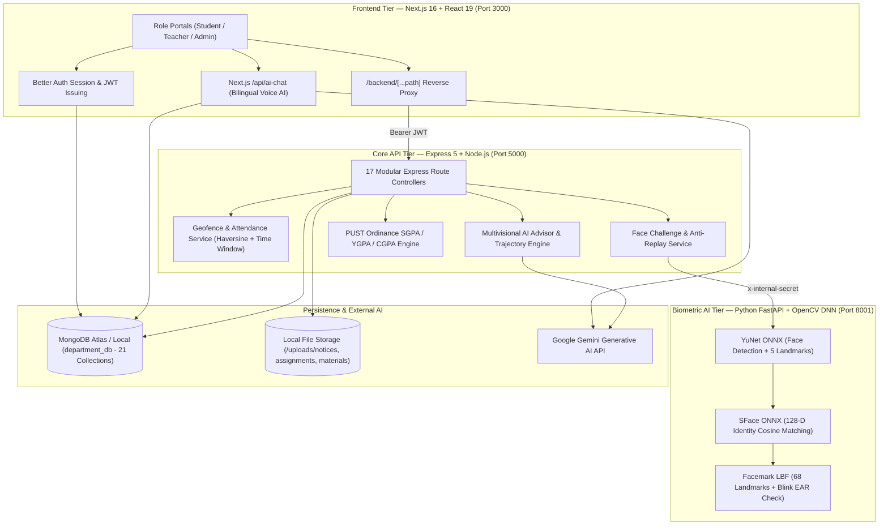

# 🎓 PUST CSE Smart Academic & Department Management Platform

**Department of Computer Science & Engineering (CSE)**  
**Pabna University of Science and Technology (PUST), Pabna-6600, Bangladesh**

A production-grade, full-stack **Smart University Department Ecosystem** engineered for the **Department of Computer Science & Engineering at PUST**. This platform unifies **Biometric Facial Liveness & 10-Meter GPS Geofence Attendance**, **PUST Ordinance-Compliant 8-Semester Result & Transcript Processing**, **Multivisional AI Academic Advising**, **Conflict-Free Routine Scheduling**, **Coursework & Class Test Management**, **AI Document-to-Note & Quiz Generation**, **Voice-Enabled Circular Broadcasting**, and **Anonymous Grievance Redressal** into a single cohesive system.

> 📌 **Master Documentation:** See the root [`README.md`](file:///d:/Department/README.md) for the complete monorepo documentation, or read the full breakdown below.

---

## 📑 Table of Contents

1. [System Architecture & Microservice Topology](#-1-system-architecture--microservice-topology)
2. [Technology Stack](#-2-technology-stack)
3. [Core Features & Role-Based Portals](#-3-core-features--role-based-portals)
   - [Student Portal & Course Workspaces](#31-student-portal--course-workspaces)
   - [Teacher Portal & Classroom Command Hub](#32-teacher-portal--classroom-command-hub)
   - [Administrator Command Center](#33-administrator-command-center)
4. [Biometric Facial Liveness & GPS Geofence Attendance Engine](#-4-biometric-facial-liveness--gps-geofence-attendance-engine)
5. [PUST Ordinance Result, Grading & Mathematical Engine](#-5-pust-ordinance-result-grading--mathematical-engine)
6. [Multivisional Academic AI Advisor & AI Study Suite](#-6-multivisional-academic-ai-advisor--ai-study-suite)
7. [Complete 8-Semester PUST CSE Curriculum](#-7-complete-8-semester-pust-cse-curriculum)
8. [Monorepo Directory Structure](#-8-monorepo-directory-structure)
9. [MongoDB Database Collections & Indexing](#-9-mongodb-database-collections--indexing)
10. [Complete REST API Reference](#-10-complete-rest-api-reference)
11. [Environment Variables & Configuration](#-11-environment-variables--configuration)
12. [Installation, Setup & Running the Project](#-12-installation-setup--running-the-project)
13. [Testing & Verification](#-13-testing--verification)

---

## 🏗️ 1. System Architecture & Microservice Topology

The project is architected as a **3-tier distributed monorepo** consisting of:
1. **`web/department-client` (Port `3000`)**: Next.js 16 (App Router) + React 19 frontend, Better Auth session server, and `/backend/*` reverse proxy.
2. **`web/department-server` (Port `5000`)**: Node.js + Express 5 core REST API server managing business logic, academic calculations, file uploads, and MongoDB persistence.
3. **`ml/face-service` (Port `8001`)**: Stateless Python FastAPI + OpenCV DNN microservice executing YuNet face detection, SFace 128-D biometric verification, and Facemark LBF 68-landmark eye-blink liveness analysis.



---

## 💻 2. Technology Stack

| Layer | Technologies & Libraries |
| :--- | :--- |
| **Frontend (`web/department-client`)** | Next.js `16.3.4` (App Router), React `19.2.8`, Tailwind CSS `v4`, HeroUI (`@heroui/react`), Framer Motion `13.2`, GSAP `3.15`, Lenis Smooth Scroll, Recharts `3.10`, Lucide React, React Hot Toast |
| **Authentication & Security** | Better Auth (`better-auth` + `@better-auth/mongo-adapter`), `jose` JWT verification (`HS256` / JWKS), Role-Based Access Control (`student`, `teacher`, `admin`), Account Approval Gate |
| **Backend (`web/department-server`)** | Node.js, Express `5.2.1`, MongoDB Native Driver `7.6.0`, Multer `2.4` (multipart uploads), `pdf-parse` (PDF text extraction), `mammoth` (DOCX text extraction) |
| **Biometric ML (`ml/face-service`)** | Python `3.10+`, FastAPI, Uvicorn, OpenCV Contrib (`opencv-contrib-python-headless`), NumPy, Pydantic, **YuNet** (`2023mar.onnx`), **SFace** (`2021dec.onnx`), **Facemark LBF** (`lbfmodel.yaml`) |
| **AI & Intelligence** | Multivisional Rule + Counterfactual Simulation Engine, Google Gemini REST API (`gemini-2.5-flash` / `gemini-2.0-flash`), Web Speech API (`SpeechRecognition` & `speechSynthesis`) |

---

## 🌟 3. Core Features & Role-Based Portals

The platform strictly enforces a **3-role architecture** (**Student**, **Teacher**, and **Administrator**). Newly registered users enter a **Pending Verification Queue** (`/pending`) until verified and approved by a Department Administrator.

### 3.1 Student Portal & Course Workspaces (`/dashboard/student`)
- **6-Section Step-Navigated Dashboard**:
  1. **Overview & Academic Identity**: Student profile card, biometric face enrollment status, active semester badge, quick KPI counters, and live visual analytics.
  2. **Weekly Class Routine**: Interactive day-by-day and full-week schedule filtered automatically for the student's active semester, displaying room allocations and course instructors.
  3. **Smart Biometric & Geofence Attendance**: Live class check-in radar showing active 10-minute attendance windows, GPS distance from the PUST CSE Building, one-click camera liveness check-in, and per-course attendance history.
  4. **Coursework, Assignments & Study Materials**: Filterable assignment hub with file upload submission, teacher feedback and grading scorecards, plus downloadable lecture slides and syllabus PDFs.
  5. **Official Academic Results, Transcript & Multivisional AI Advisor**:
     - Interactive semester-by-semester transcript viewer (Semesters 1 to 8) with PUST Ordinance marks breakdown (`Attendance /10`, `CA /20 or /30`, `Final Exam /70 or /60`, `Total /100`, `Grade`, `GP`, `SGPA`, `YGPA`, `CGPA`).
     - Printable/exportable official grade sheets.
     - **8-Semester Degree Forecast & Multivisional AI Advisor** with an interactive progression curve and full-featured academic chatbot.
  6. **Notice Board & Profile Settings**: Department-wide and course-specific notices with embedded audio voice players, plus profile & biometric face re-enrollment controls.
- **Dedicated Student Course Workspace (`/dashboard/student/courses/[courseCode]`)**:
  - Focused single-course environment featuring:
    - **Live Course Attendance Check-In & History**
    - **Course Lecture Materials & Downloads**
    - **Course Assignments & Submission Portal**
    - **Class Test (CT) Marks & Continuous Assessment Tracker**
    - **Direct Course Chat (`StudentCourseChat`)**: Real-time WhatsApp-style messaging with the course teacher.
    - **AI Study Note & Quiz Studio (`StudentCourseAIStudy`)**: Upload any lecture PDF/DOCX/TXT or enter a topic to generate structured revision notes and interactive self-assessment quizzes.

### 3.2 Teacher Portal & Classroom Command Hub (`/dashboard/teacher`)
- **6-Section Faculty Dashboard**:
  1. **Faculty Overview**: Personal academic profile, teaching load metrics, live session indicators, and quick **Give Course Notice** broadcaster.
  2. **Personal Teaching Routine**: Weekly lecture and lab schedule across all assigned semesters with room and time-slot highlights.
  3. **Assigned Courses Hub**: Cards for every course assigned to the faculty member with direct entry into each **Course Workspace** and one-click course notice broadcasting.
  4. **Live Classroom Attendance Control**: Start or close 10-minute biometric check-in windows, inspect live student check-ins, and review course attendance percentages.
  5. **Assignments & Grading Studio**: Create coursework assignments with attachments and due dates, inspect student submissions, and publish marks with feedback.
  6. **Circulars & Faculty Profile**: Read/broadcast notices (with voice memo recording) and manage faculty contact/office details.
- **Dedicated Teacher Course Workspace (`/dashboard/teacher/courses/[courseCode]`)**:
  - **10-Minute Live Attendance Launcher**: Opens geofenced & face-verified attendance windows during scheduled class slots, with live countdown timer, manual override (`Present`/`Absent`), and one-click **CSV Attendance Export**.
  - **Enrolled Student Roster**: Complete list of students enrolled in the course's semester with individual attendance and grade metrics.
  - **Course Materials Manager**: Upload lecture slides, PDFs, PPTX, and reference documents.
  - **Assignments & Evaluation**: Post assignments and grade student file submissions.
  - **Offline Class Tests (CT) Manager**: Create Class Tests (`CT-1`, `CT-2`, etc.) and record/update marks for all students in the course.
  - **Course Notice Broadcaster**: Publish targeted text, file, and voice announcements exclusively to students of that course.
  - **Direct Student-Teacher Messaging (`TeacherCourseChat`)**: 1-on-1 course-contextual messaging thread with each enrolled student.

### 3.3 Administrator Command Center (`/dashboard/admin`)
- **Streamlined Top-Navigation Architecture**:
  - Clean, theme-consistent top command bar and section switcher supporting both Light and Dark modes without redundant sidebar clutter.
- **5 Core Administrative Modules**:
  1. **Executive Overview & Telemetry**: Real-time departmental KPIs (Total Students, Faculty Members, Courses, Pending Approvals, Active Routine Slots, Unresolved Grievances) and interactive distribution charts.
  2. **User Verification & Directory Management**:
     - Approve or reject pending student and teacher registrations individually or via **Bulk Approve All**.
     - Manage approved users, update roles (`student`, `teacher`, `admin`), assign courses to teachers, or remove accounts.
  3. **Conflict-Free Master Routine Studio**:
     - Interactive 7-day (`Saturday` – `Friday`) × 7-slot (`09:00` – `05:00`) timetable builder for Semesters 1 to 8.
     - **Real-Time Conflict Engine**: Automatically blocks room double-booking and teacher schedule collisions across semesters.
     - Supports adding custom curriculum courses on the fly.
  4. **PUST Ordinance Semester Result & Transcript Engine (`AdminResultsSection`)**:
     - Publish, edit, or delete semester results (Semesters 1 to 8) with auto-calculated grades from component marks (`Attendance` + `CA` + `Final`).
     - **Realistic Cohort Variation Seeder**: Generates realistic academic distributions across the student body (honors toppers, first-class students, borderline pass students, and failing/retake cases) and automatically recalculates chronological `SGPA`, `YGPA`, and `CGPA`.
  5. **Grievance Resolution Desk & Official Notice Broadcaster**:
     - Inspect and resolve Confidential Grievances (`CMP-XXXX-XXXX`), IT Support Tickets (`IT-XXXX-XXXX`), and General Inquiries (`INQ-XXXX-XXXX`) with admin response notes.
     - Publish department-wide notices with PDF/image attachments and recorded voice announcements.

---

## 🛡️ 4. Biometric Facial Liveness & GPS Geofence Attendance Engine

To eliminate proxy attendance, every student check-in must pass **three independent verification gates**:

1. **Gate 1 — Time Window Enforcement**: Check-in is only accepted while the 10-minute session window opened by the course teacher (or scheduled slot) is active.
2. **Gate 2 — 10-Meter Haversine GPS Geofence**: Computes exact geodesic distance between the student's GPS coordinates and the **PUST CSE Building (`24.01296° N, 89.280835° E`)**, rejecting inaccurate GPS fixes.
3. **Gate 3 — Active 3-Step Biometric Liveness (`ml/face-service`)**:
   - **Frontal Anchor (`center`)**: Extracts a 128-dimensional **SFace** feature vector and verifies cosine similarity $\ge 0.42$ against the student's enrolled template.
   - **3D Head Yaw Verification (`left` / `right`)**: Computes the horizontal nose-to-eye ratio $\frac{x_{\text{nose}} - x_{\text{rightEye}}}{x_{\text{leftEye}} - x_{\text{rightEye}}}$ to defeat flat 2D photo/screen spoofing.
   - **Eye Aspect Ratio Blink Verification (`blink`)**: Uses **68-landmark Facemark LBF** to measure vertical-to-horizontal eye opening across a multi-frame burst, requiring a natural blink drop of $\ge 22\%$.

---

## 📐 5. PUST Ordinance Result, Grading & Mathematical Engine

The result management system strictly implements the **Pabna University of Science and Technology (PUST) Academic Ordinance**:

- **Theory Courses (100 Marks)**: Attendance (`10`) + Continuous Assessment (`20`) + Final Exam (`70`).
- **Sessional / Lab Courses (100 Marks)**: Attendance (`10`) + Lab Assessment (`30`) + Final Lab/Viva (`60`).
- **Attendance Marks Scale (Sec 20.8 iv)**: $\ge 90\% \rightarrow 10$, $85\text{–}89\% \rightarrow 9$, $80\text{–}84\% \rightarrow 8$, $75\text{–}79\% \rightarrow 7$, $70\text{–}74\% \rightarrow 6$, $60\text{–}69\% \rightarrow 5$, $< 60\% \rightarrow 0$.
- **10-Tier Grading Scale**: `A+` ($80\%+$, `4.00`), `A` ($75\text{–}79\%$, `3.75`), `A-` ($70\text{–}74\%$, `3.50`), `B+` ($65\text{–}69\%$, `3.25`), `B` ($60\text{–}64\%$, `3.00`), `B-` ($55\text{–}59\%$, `2.75`), `C+` ($50\text{–}54\%$, `2.50`), `C` ($45\text{–}49\%$, `2.25`), `D` ($40\text{–}44\%$, `2.00`), `F` ($<40\%$, `0.00`).
- **Equations**:
  - $\text{SGPA} = \frac{\sum C_i G_i}{\sum C_i}$
  - $\text{YGPA}_{\text{Year } y} = \frac{\text{Total Grade Points of Semesters } (2y-1) \text{ and } (2y)}{\text{Total Credits of Semesters } (2y-1) \text{ and } (2y)}$
  - $\text{CGPA} = \frac{\sum C_k G_k}{\sum C_k}$

---

## 🧠 6. Multivisional Academic AI Advisor & AI Study Suite

- **Multivisional Academic AI Chatbot (`StudentAIForecastCard.jsx` & `aiAdvisor.service.js`)**:
  - Generates a **5-Vision Multivisional Report** for any semester (`Semester 1–8`), including official standing, batch cohort rank, full course-by-course marks table, Theory vs. Lab GPA split, semester-over-semester momentum, and counterfactual attendance simulations.
  - Learns live website data across `routines`, `attendance_sessions`, `attendance_records`, `assignments`, `assignment_submissions`, `class_tests`, `materials`, `notices`, and `teachers`.
- **AI Study Note & Quiz Studio (`StudentCourseAIStudy.jsx` & `aiStudy.routes.js`)**:
  - Parses `.pdf`, `.docx`, and `.txt` lecture files to generate structured revision notes and interactive MCQ quizzes.
- **Bilingual Voice-Enabled Floating AI Assistant (`AiChatBot.jsx` & `/api/ai-chat`)**:
  - Supports English and Bengali (`বাংলা`) with Speech-to-Text and Text-to-Speech.

---

## 📚 7. Complete 8-Semester PUST CSE Curriculum

| Semester | Academic Term | Total Courses | Total Credits | Core Subjects Highlight |
| :---: | :--- | :---: | :---: | :--- |
| **Semester 1** | 1st Year, 1st Semester | 9 | `19.50` | Computer Fundamentals, Structured Programming (C), Calculus, Physics, English |
| **Semester 2** | 1st Year, 2nd Semester | 10 | `19.50` | Object Oriented Programming (C++), Discrete Math, Basic Electrical Engg, Engineering Drawing |
| **Semester 3** | 2nd Year, 1st Semester | 10 | `20.25` | Data Structures, Design Pattern & Java, Electronic Devices, Linear Algebra, Mobile App Project |
| **Semester 4** | 2nd Year, 2nd Semester | 9 | `19.25` | Algorithms, Theory of Computation, Digital Systems, Complex Analysis, Hardware Project |
| **Semester 5** | 3rd Year, 1st Semester | 11 | `21.00` | Computer Architecture, Compiler Design, Numerical Methods, DBMS, Data Communication |
| **Semester 6** | 3rd Year, 2nd Semester | 11 | `22.00` | System Analysis & Design, Operating Systems, Web Engineering, DSP, Microprocessors & Assembly |
| **Semester 7** | 4th Year, 1st Semester | 10 | `20.25` | Software Engineering, Artificial Intelligence, Digital Image Processing, Machine Learning, Thesis I |
| **Semester 8** | 4th Year, 2nd Semester | 10 | `20.50` | Computer Networks, Computer Graphics, Microcontrollers, HCI, Industrial Management, Thesis II |

---

## 📂 8. Monorepo Directory Structure

- `ml/face-service`: FastAPI + OpenCV DNN (`YuNet`, `SFace`, `Facemark LBF`) biometric microservice on Port `8001`.
- `web/department-server`: Express 5 + MongoDB core backend API server on Port `5000`.
- `web/department-client`: Next.js 16 + React 19 frontend client on Port `3000`.

---

## 🗄️ 9. MongoDB Database Collections & Indexing

21 collections in `department_db`: `user`, `session`, `account`, `students`, `teachers`, `admins`, `routines`, `courses`, `attendance_sessions`, `attendance_records`, `face_profiles`, `face_challenges`, `attendance_attempts`, `semester_results`, `assignments`, `assignment_submissions`, `materials`, `class_tests`, `notices`, `course_messages`, `student_study_notes`, `complaints`, and `support_tickets`.

---

## 🔌 10. Complete REST API Reference

17 modular Express route groups mounted under `/api`:
- `/api/me`, `/api/students`, `/api/teachers`, `/api/admin`, `/api/users`
- `/api/face`, `/api/attendance`
- `/api/results` (`/student/my-results`, `/student/ai-forecast`, `/student/ai-coach-chat`, `/admin/all`, `/admin/save`, `/admin/seed-variations`)
- `/api/routines`, `/api/courses`, `/api/assignments`, `/api/materials`, `/api/class-tests`, `/api/course-messages`, `/api/ai-study`, `/api/notices`, `/api/support`

---

## ⚙️ 11. Environment Variables & Configuration

Configure `.env` files in:
- `web/department-client/.env.local` (`BETTER_AUTH_SECRET`, `BETTER_AUTH_URL`, `MONGODB_URI`, `BACKEND_URL`, `NEXT_PUBLIC_API_URL`, `GEMINI_API_KEY`)
- `web/department-server/.env` (`PORT=5000`, `MONGO_URI`, `BETTER_AUTH_SECRET`, `FACE_SERVICE_URL=http://127.0.0.1:8001`, `FACE_SERVICE_SECRET`, `GEMINI_API_KEY`)
- `ml/face-service/.env` (`FACE_SERVICE_SECRET`, `FACE_MATCH_THRESHOLD=0.42`, `FACE_REQUIRE_BLINK=true`)

---

## 🚀 12. Installation, Setup & Running the Project

1. **Biometric Face Service (`Port 8001`)**:
   ```bash
   cd ml/face-service
   .\.venv\Scripts\python.exe -m uvicorn app:app --host 127.0.0.1 --port 8001
   ```
2. **Express Core Server (`Port 5000`)**:
   ```bash
   cd web/department-server
   npm install && npm start
   ```
3. **Next.js Frontend (`Port 3000`)**:
   ```bash
   cd web/department-client
   npm install && npm run dev
   ```

---

## 🧪 13. Testing & Verification

```bash
cd web/department-server
npm test
```

---

*Engineered for the **Department of Computer Science & Engineering, Pabna University of Science and Technology (PUST)**.*
